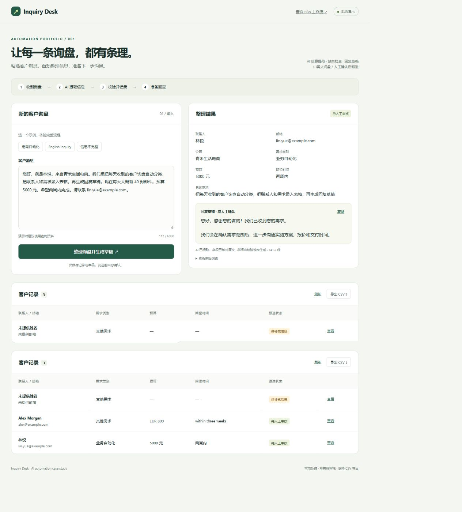
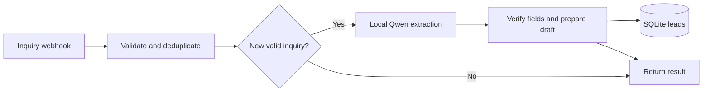

# Inquiry Desk

**Turn customer inquiries into structured leads and review-ready replies.**

n8n · Python · Ollama · SQLite | [中文说明](README.md) | [Importable workflow](workflow.json)

An AI automation portfolio project for a common small-business task: reading inquiries, copying contact details into a spreadsheet, and preparing a follow-up. Paste an English or Chinese message to extract contact details, requirements, budget, and timeline; flag missing information; and prepare a reply for human review.

**[Try the browser demo on Hugging Face](https://huggingface.co/spaces/yesyanyan/inquiry-desk)** · [Demo source](hf-space/)

The hosted companion offers clearly labeled recorded examples and on-device browser AI extraction. First use downloads model weights; records are cleared on refresh. The full n8n + Python application shown above runs locally and requires your own n8n and Ollama instances. The interface is in Chinese, with Chinese and English example inquiries. No paid AI API key is required.

## Workflow

- n8n orchestrates HTTP calls, branches, retries, and responses.
- Local Qwen extracts structured fields. Python checks them against the original message.
- Message hashes and a database unique constraint prevent duplicate writes, including concurrent submissions.
- If extraction fails, the original message is saved for review and can be retried.
- Reply drafts use validated Chinese or English **templates**, not free-form AI generation. Nothing is emailed automatically.
- A lead table, copyable drafts, and CSV export complete the demo.

## Run locally

1. Prepare Python 3.10+, n8n, and Ollama with `qwen3-vl:2b` installed. No third-party Python packages are required. The workflow was tested on n8n 2.35.7.
2. Run `python app.py` from the repository directory. On Windows, `./start.ps1` starts it in the background.
3. Import `workflow.json` into n8n. Its Python URLs use `http://host.docker.internal:8769`, for n8n running in Docker Desktop and Python on the host. Its Ollama URL is `http://ollama:11434/api/chat`, assuming a shared Docker network and the service name `ollama`. Adjust these URLs for your deployment.
4. Publish the workflow. The application expects n8n at `http://127.0.0.1:5678` by default.
5. Open `http://127.0.0.1:8769` on the same computer. Select a sample inquiry, submit, review the results, then export CSV.

You can configure `N8N_WEBHOOK_URL`, `INQUIRY_MODEL`, `INQUIRY_PORT`, and `INQUIRY_DB` through environment variables. Changing the Python port also requires updating workflow URLs. The background launcher, UI workflow link, and smoke test use the default ports.

## Validation

Run `python -m unittest -v` for nine isolated tests covering validation, hallucinated fields, deduplication, concurrent writes, AI failure recovery, Qwen output compatibility, ambiguous email addresses, and CSV formula escaping.

Run `python smoke_test.py` against a running local stack for Chinese, English, incomplete-inquiry, duplicate, invalid-input, and export checks. This writes fictional demo records. `verification.json` records a local run; its Chinese case reused an earlier Qwen 8B result. These are functional checks, not an accuracy or speed benchmark. First model loads can be significantly slower than warm requests.

## Scope

This is a fictional business case, not a claimed client engagement. Real email ingestion, CRM/Google Sheets integration, and online hosting are future extensions. The model performs extraction; replies are template-generated and require human review.

The Python server binds to loopback for a single-user local demo and has no multi-user authentication. A production deployment needs appropriate access control, rate limiting, backups, and data retention. Substring checks reject some hallucinations but cannot establish semantic correctness. The table and CSV return at most 500 recent records.

Local databases, logs, environment files, and caches are excluded from the repository. Included sample identities and `example.com` addresses are fictional.

See [the case study and recording script](CASE_STUDY.md) for a walkthrough.
