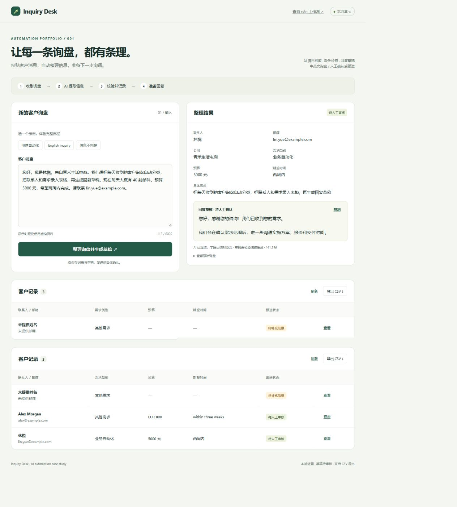
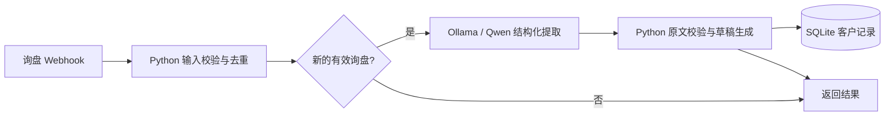

# Inquiry Desk — AI 询盘自动整理助手

[English overview](README.en.md) · n8n + Python + Ollama

**[在线体验：Hugging Face Space](https://huggingface.co/spaces/helloyansquared/inquiry-desk)** · [浏览器演示源码](hf-space/)

在线版提供明确标注的预录案例和浏览器 AI 提取；首次运行 AI 需下载模型，记录刷新即清空。完整 n8n + Python + Ollama 流程在本机运行，下方截图来自该版本。文中的 `127.0.0.1` 地址仅在部署电脑上有效。

把客户的一段消息转换成可跟进的客户记录：提取联系人、公司、需求、预算和时间，检查缺失信息，生成待人工确认的回复草稿。

这是一个本地可运行的 **n8n + Python + Ollama** 作品集案例。AI 负责提取，Python 负责校验和存储，n8n 负责编排。使用虚构询盘演示；没有接入真实邮箱，也不会自动发送消息。



## 体验

1. 运行 `./start.ps1`（Windows / Python 3.10+，无第三方 Python 依赖）。
2. 打开 <http://127.0.0.1:8769>。
3. 点击“电商自动化”“English inquiry”或“信息不完整”，然后提交。
4. 查看提取结果、待补充信息、回复草稿和客户记录。
5. 再次提交同一消息，验证不会重复入库；点击“导出 CSV”下载客户表。

本机工作流：<http://127.0.0.1:5678/workflow/portfolioInquiryDeskV1>。查看编辑器需要使用自己的 n8n 账号登录。演示网页无需登录。

## 工作流



- **真实 AI 提取**：本地 `qwen3-vl:2b`，JSON schema 限定输出；未使用硬编码结果冒充 AI。也可通过环境变量切换模型。
- **原文校验**：除类别外，提取字段必须能在原文找到；无法核实的内容置空并标记。类别仍是模型判断，须人工审核。
- **草稿生成**：根据校验后的缺失字段，使用中英文模板生成。它是模板草稿，不是自由生成的 AI 邮件，不承诺价格或交付日期。
- **幂等入库**：原文经过空白归一化后计算 SHA-256；SQLite 唯一约束防止并发重复写入。
- **失败处理**：模型超时或格式错误时保存原文并标记人工整理。重新提交可再次提取并更新原记录。Python 服务暂时失败会重试；n8n 故障会在页面提示。
- **导出**：CSV 为 UTF-8 BOM，中文可读，并处理常见表格公式注入前缀。

## 在其他电脑复现

1. 准备 Python 3.10+、n8n 和 Ollama，安装 `qwen3-vl:2b` 模型。
2. 启动本目录中的 `app.py`，默认监听 `127.0.0.1:8769`。
3. 在 n8n 中导入 `workflow.json`。
4. 按部署环境修改 HTTP Request 节点地址：
   - Python 服务：当前为 `http://host.docker.internal:8769`，适用于本机 Docker Desktop 中的 n8n。
   - Ollama：当前为同一 Docker 网络中的 `http://ollama:11434`。
5. 发布工作流。前端提交到本机 n8n 的 `/webhook/portfolio-inquiry-desk-v1`。
6. 环境变量可覆盖 `N8N_WEBHOOK_URL`、`INQUIRY_MODEL`、`INQUIRY_DB`、`INQUIRY_PORT`；修改端口时也要修改工作流中的 Python 地址。

命令行导入示例（将容器名替换为你的实例）：

```powershell
docker cp workflow.json YOUR_N8N_CONTAINER:/tmp/inquiry-desk.json
docker exec YOUR_N8N_CONTAINER n8n import:workflow --input=/tmp/inquiry-desk.json
```

可以在编辑器中发布。n8n 2.35.7 的 `publish:workflow` 命令需要重启实例才生效，重启前先确认没有在运行的任务。

## 文件

| 文件 | 用途 |
|---|---|
| `workflow.json` | 可导入 n8n 的完整工作流，不含凭据 |
| `app.py` | Web 服务、数据校验、草稿模板、SQLite、CSV |
| `web/index.html` | 可操作的中文作品展示页面 |
| `build_workflow.py` | 重新生成工作流 JSON |
| `test_app.py` | 数据完整性、异常和并发去重测试 |
| `smoke_test.py` | 真实 n8n + AI 端到端验证，会写入虚构示例记录 |
| `start.ps1` | Windows 后台启动脚本 |
| `CASE_STUDY.md` | 可用于作品集的案例说明与录屏脚本 |

## 测试

```powershell
python -m unittest -v
python smoke_test.py
```

单元测试使用独立临时数据库，不修改演示记录。`smoke_test.py` 会写入虚构示例记录。实际数据在 `data/leads.sqlite3`；数据、运行日志已加入 `.gitignore`，不包含在待发布文件中。

## 范围与限制

这是本机单人演示，HTTP 服务仅监听回环地址，没有多用户鉴权，不应直接映射到公网。接客户部署时需加入认证、请求限流、队列、备份和适当的数据保留策略。原文匹配只能过滤部分幻觉，不能证明提取的语义正确；所有草稿都需要人工确认。重复判断基于消息全文，不会把同一客户的不同询盘合并。页面与 CSV 最多返回最近 500 条。

真实邮箱、Google Sheets/CRM 和在线托管不在当前版本内；可以在客户确定使用的工具后替换输入与存储节点。

参考：[n8n CLI 官方文档源码](https://github.com/n8n-io/n8n-docs/blob/main/docs/deploy/host-n8n/configure-n8n/use-the-command-line.md)、[Ollama structured outputs](https://docs.ollama.com/capabilities/structured-outputs)。
